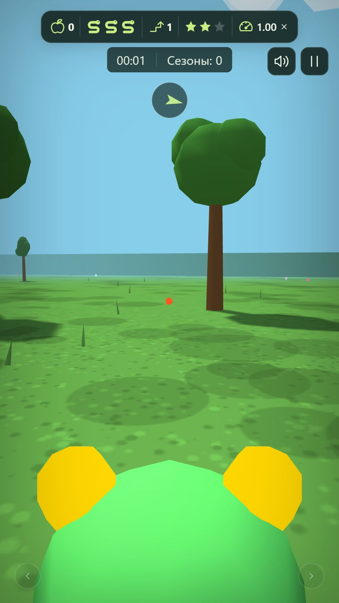
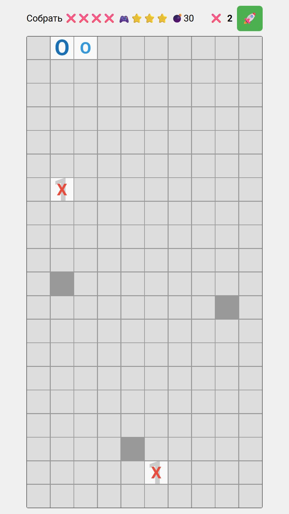

# Игры Ильи Барило

Я собираю здесь свои браузерные игры, витрины для их представления
и материалы о разработке. В описаниях рассказываю, зачем появилась каждая
игра, как развивался её замысел, какие решения я выбирал и какую роль
в создании играл ИИ.

  
  
  

  
  
  

[Все выпуски](https://github.com/IlyaBarilo/games/releases)

## Игры

| Игра | Что в ней есть |
|---|---|
| [Змейка 3D](content/games/snake3d-turns.md) | Змейка от первого лица в саду четырёх сезонов: сбор фруктов, препятствия, рост деревьев и случайные события. Есть демонстрационный режим. |
| [Крестики-нолики с сапёром](content/games/tictac.md) | Игра против компьютера: нужно собрать линию своих фигур и избежать скрытых мин. Числа в открытых клетках показывают количество мин вокруг. |
| Змейка: эволюция видеоигр | Путешествие через 11 эпох: от терминала 1980 года до трёхмерного фруктового сада. Есть режим на рекорд и пять сложностей. |
| Диагностика интерактивного экрана | Тестовая мини-игра: касания, мультитач, точность ввода, FPS и автоматическая проверка графической нагрузки. |
| Робосклад | Крестики-нолики с неисправными плитами, подсказками и механическими руками. Запуск доступен в обеих витринах. |
| [Шарики с поздравлениями к 8 Марта](content/games/8march-shariki.md) | Воздушные шарики со случайными поздравлениями на ИТ-тему. Нажмите на шарик, чтобы прочитать поздравление, затем выберите другой. |

Ссылки в названиях игр и скриншоты ведут к описаниям: их замыслу, механикам и истории создания.

| [Змейка 3D](content/games/snake3d-turns.md) | [Крестики-нолики с сапёром](content/games/tictac.md) | [Шарики с поздравлениями](content/games/8march-shariki.md) |
|---|---|---|
|  |  |  |

## Витрины

Для коллекции предусмотрены два варианта представления:

- **Сайт** — 3D-павильон с игровыми стендами. Между ними можно перемещаться,
  выбирать сложность и запускать игры. У каждого стенда доступна информация
  об игре, а для подготовленных описаний — отдельная страница с текстом и фотографиями.
- **GameSpace** — автономный комплект с 3D-павильоном, 2D-витриной и описаниями
  для запуска в [GameSpace](https://github.com/IlyaBarilo/gamespace). При первом входе
  открывается 3D; можно переключиться в 2D и обратно. Выбранный режим запоминается.

Обе витрины представляют одну коллекцию игр.

## Разработка игр

В материалах к каждой игре я описываю:

- исходную идею и задачу;
- развитие механик, оформление и особенности взаимодействия;
- свой вклад и роль ИИ;
- способы проверки и опыт использования.

Эти описания доступны по ссылкам в таблице игр и на страницах сайта.

## Автор и условия использования

Автор — [Илья Барило](https://barilo.ru/).

Авторские игры, код, тексты, фотографии и другие материалы распространяются
на собственных условиях использования. Разрешены личное
некоммерческое использование, изучение кода и обычные занятия со своей
группой обучающихся или воспитанников в образовательных организациях
и кружках, включая дополнительное образование.

Показы другими выступающими и организаторами на мероприятиях,
распространение копий и иное коммерческое использование требуют
предварительного письменного согласования с автором. Исходники доступны
для изучения с ограничениями; это не лицензия Open Source.

Сторонние компоненты сохраняют собственные условия:
[перечень и полные тексты лицензий](NOTICE.md).
