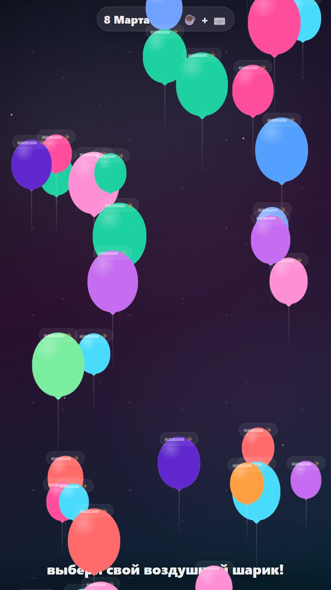
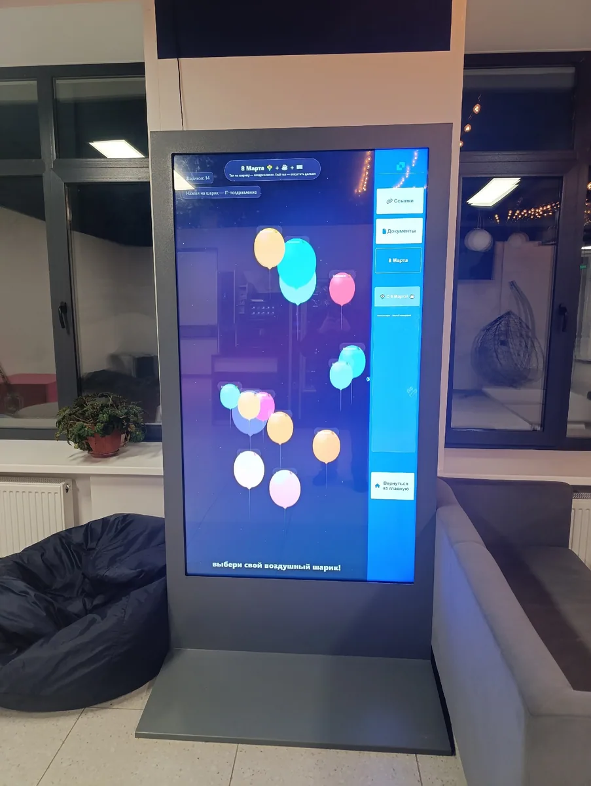
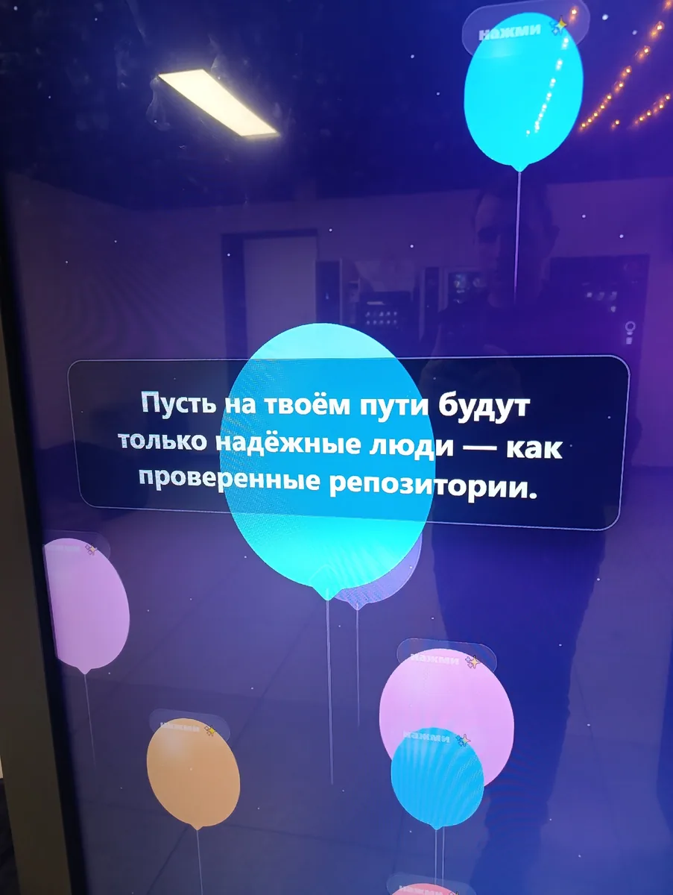

# Шарики с поздравлениями к 8 Марта

Воздушные шарики с праздничными поздравлениями на ИТ-тему. Можно нажать на выбранный шарик и прочитать случайное поздравление. Гости могут по очереди выбирать шарики и получать поздравления.

## Скриншоты игры

*Шарики разных цветов и размеров поднимаются вверх. Можно выбрать любой из них, чтобы получить поздравление.*

*Выбранный шарик увеличивается и показывает случайное поздравление. После чтения можно закрыть текст или выбрать другой шарик.*

## Зачем я её сделал

На первом этаже Б-корпуса вуза был большой вертикальный интерактивный экран — инфокиоск, на котором раньше можно было смотреть расписание занятий и другую информацию. Я решил создать для него игру на тему ближайшего праздника — 8 Марта и расширить возможности использования экрана.

Хотел сделать ИТ-поздравления для учащихся, преподавателей и гостей корпуса. Для гостей это должно было не только создать хорошее настроение, но и показать ИТ-возможности института. Поэтому и сами поздравления я хотел связать с ИТ-темой и праздником.

## Как устроено взаимодействие

По экрану снизу вверх поднимаются шарики разных цветов и размеров. Достаточно нажать на выбранный шарик, чтобы он увеличился и показал случайное поздравление. На время чтения выбранный шарик останавливается.

Нажатие на свободное место экрана скрывает поздравление. Можно также сразу выбрать другой шарик: предыдущее поздравление закроется, а новое откроется. Так гости могут по очереди выбирать шарики и получать поздравления.

Поздравления выбираются из подготовленного списка. При выборе исключаются последние 20 показанных текстов, чтобы они не повторялись у следующих гостей сразу же.

## Что было важно при доработке

### Оформление и движение шариков

Игра получилась довольно быстро. Работа началась с простых шариков. В процессе доработки я улучшал их оформление и добивался плавного движения вверх с колебаниями, имитирующими поведение воздушных шариков.

В текущем варианте у шариков различаются размеры, цвета и скорость подъёма. При движении вверх они также смещаются в стороны. Вместо шариков, которые выходят за верхнюю границу экрана, продолжают появляться новые.

### Поздравления, которые удобно дополнять

Одним из ключевых требований было расположить тексты поздравлений в коде так, чтобы их можно было легко находить и исправлять. Они собраны в отдельном списке настроек.

Я хотел иметь возможность на следующих этапах создавать новые поздравления, выбирать лучшие и добавлять их в игру. Поэтому уделял внимание и содержанию текстов, и тому, чтобы поздравлений было много.

### Большой вертикальный экран

Нужно было адаптировать игру для высокого разрешения вертикального экрана и проверить работу при касаниях. В игре предусмотрено масштабирование под размер окна. При открытии поздравления положение шарика корректируется, чтобы текст помещался на экране.

## Роль ИИ и моя работа

Идею игры я придумал сам. Для реализации использовал чат ChatGPT: ИИ писал код по моим запросам.

Сначала я перенёс в файл весь полученный код. Затем запрашивал доработки и заменял отдельные части файла готовыми фрагментами из ответов ChatGPT. Работа проходила через ИИ-чат.

## Как я проверял игру

Сначала проверял игру на компьютере в браузере: в обычном режиме и в режиме просмотра на мобильном устройстве. Также имитировал высокие разрешения экрана.

После этого игру разместили на интерактивном экране через программу со встроенным браузерным движком для отображения HTML. Там проверяли её работу на самом экране.

Особое внимание уделял текстам поздравлений и их добавлению, адаптации к большому разрешению вертикального экрана и работе с интерактивным экраном.

## Как использовали результат

К празднику на инфокиоске разместили две игры: шарики с пожеланиями от ИТ-шников и пазлы. Игры были временными, только на праздничный период. Об этом я рассказал в посте для ВК, подготовленном 7 марта.

Коллеги проводили экскурсии и предлагали гостям выбрать поздравление на экране.

После установки я получил отзывы от коллег, которые проводили эти экскурсии.

## Фотографии на интерактивном экране

