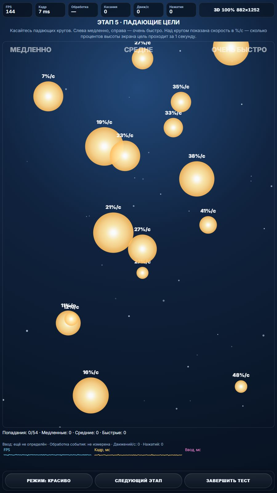
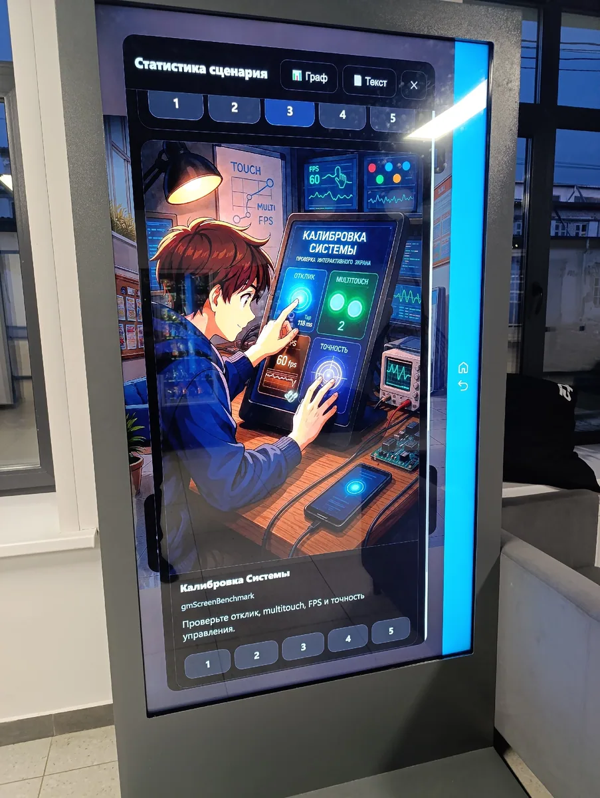
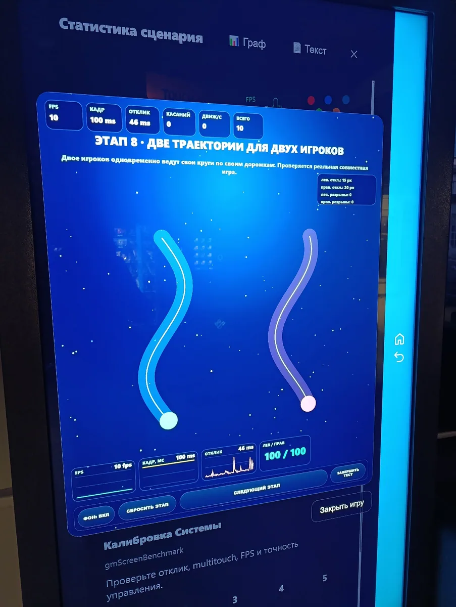
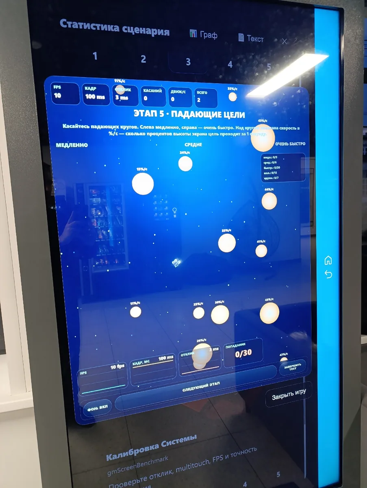
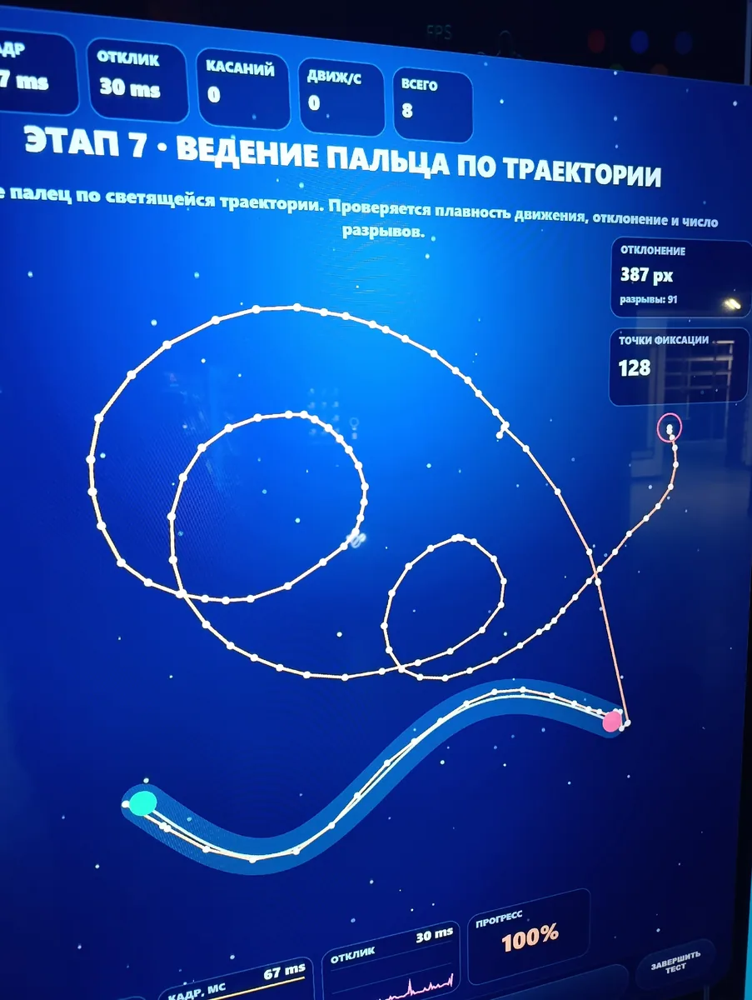
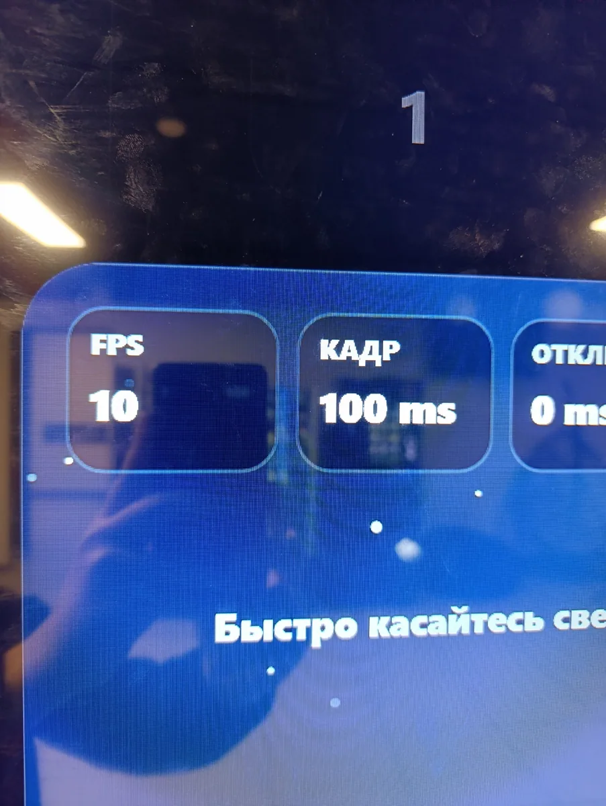

# Диагностика интерактивного экрана

Инструмент для проверки касаний, мультитача, точности движения и производительности. Помогает на практике определить возможности устройства и подобрать подходящие настройки для игр.

## Зачем я её сделал

При запуске игр на вертикальном интерактивном экране в корпусе я столкнулся с низкой частотой перерисовки (FPS) и задержкой реакции на нажатия.

Нужно было на практике выяснить ограничения экрана: как он справляется с отрисовкой сложных сцен, сколько одновременных касаний фиксирует, насколько точно отслеживает перемещение пальцев и при какой скорости движения объектов пользователь уверенно по ним попадает.

Программа подключена в демо-версии новеллы, созданной на разработанном мной движке визуальных новелл. Она позволяет проверять устройства для дальнейшей разработки мини-игр в новелле. Затем я стал использовать приложение и отдельно, в том числе для тестирования телефонов.

## Как работают проверки

В текущем варианте девять этапов:

1. **Регистрация нажатий.** Нужно попадать по движущейся цели; отображаются попадания, FPS и время обработки события.
2. **Две зоны нажатий.** Можно одновременно проверять действия двух игроков, серии нажатий и их темп.
3. **Два объекта за пальцами.** Два круга нужно одновременно перетаскивать по экрану.
4. **Мультитач.** Проверяется количество одновременных касаний, включая максимальное и устойчивое число.
5. **Падающие цели.** Круги разных размеров падают с разной скоростью.
6. **Базовый FPS.** Почти пустая сцена позволяет посмотреть производительность без дополнительной нагрузки.
7. **Ведение по траектории.** Проверяются отклонения от линии, разрывы и прогресс прохождения.
8. **Две траектории.** Два игрока одновременно ведут объекты по отдельным дорожкам.
9. **Автодиагностика нагрузки.** Программа сравнивает влияние размытия, отображения показателей, эффектов и снижения разрешения.

Показатель задержки относится к доставке и обработке события в браузере. Полная задержка от касания сенсора до изменения изображения на экране здесь не измеряется.

## Как развивалась программа

Изначально я планировал проверки FPS, количества одновременных нажатий, движения указателя по экрану и одновременного перемещения нескольких объектов.

Необходимо было проверить задержку нажатия и найти скорость, при которой пользователь уверенно попадает по движущейся цели, чтобы затем настроить сложность игры.

Постепенно добавлялись другие этапы и расширялся функционал первоначально запланированных проверок.

## Что было важно при доработке

### Падающие цели

Придумал проверку с шарами, падающими вниз с разной скоростью. Слева направо скорость увеличивается: в левой части экрана цели движутся медленно, в правой — значительно быстрее.

Для каждого шара добавлена подпись со скоростью. Это позволяет на одном экране попробовать разные варианты, выбрать подходящую скорость и затем указать её при корректировке игры. Скорость указана в процентах высоты игрового поля в секунду для универсального расчета и возможности провоерки удобной скорости для разных разрешений.

*Проверка «Падающие цели»: слева круги движутся медленнее, справа — быстрее. Над каждым указана его скорость.*

### Влияние интерфейса на производительность

Для отслеживания изменений были добавлены графики, а для оформления — красивый фон. Но они сами сильно влияли на производительность.

Графики пришлось упростить. Также была добавлена кнопка переключения режима, который упрощает фон и другие элементы, чтобы снизить влияние интерфейса на нагрузку.

## Роль ИИ и моя работа

Для разработки я использовал ИИ-агент Codex.

Я определял, какие возможности экрана нужно проверить и как результаты помогут при разработке игр. В частности, придумал проверку с падающими шарами разных скоростей и подписями, по которым можно выбрать подходящий вариант.

## Как я проверял программу

Прежде всего я проверял её на интерактивном экране в корпусе: именно для него программа и была первоначально разработана.

*На фотографиях ниже — ранняя версия программы на интерактивном экране в корпусе.*

Позже она пригодилась и для тестирования телефонов и других устройств.

## Что получилось

Инструмент помог проверить технические возможности интерактивного экрана в корпусе и найти оптимальные настройки для игр.

По результатам стало понятнее, какие возможности можно использовать в играх на этом экране, а какие следует ограничить или убрать из-за его технических особенностей. Программа использовалась при подготовке заданий для курсовой работы.
