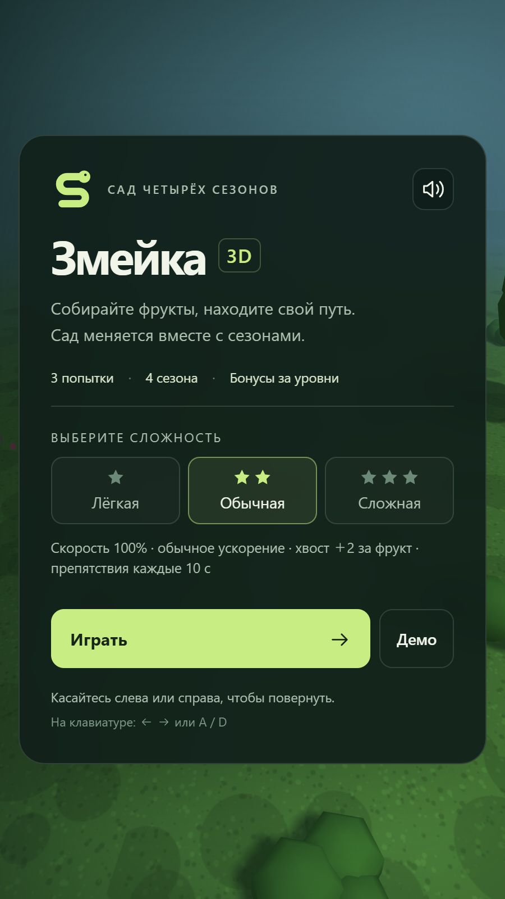

# Змейка 3D

Змейка от первого лица в саду четырёх сезонов. Здесь нужно собирать фрукты и обходить препятствия, пока вокруг меняется мир: растут деревья и кусты, сменяются сезоны и происходят случайные события.

## Скриншоты игры

*Игровой вид от первого лица. Вверху показаны очки, попытки, уровень, сложность, скорость и время игры.*

*Стартовое меню с тремя сложностями и отдельным запуском демонстрационного режима.*

## Зачем я её сделал

Изначально я хотел сравнить, как разные нейросети справляются с созданием HTML-игры из одного промпта. Для эксперимента выбрал змейку.

В другом моём проекте уже были разные варианты этой игры. Финальный уровень проходил от первого лица в саду — эту идею я включил и в новый промпт.

Из полученных вариантов мне понравилась визуальная часть игры, созданной чат-ботом Яндекс Алиса. Сама игра была простой, а направление поворотов работало неправильно. Этот вариант стал одним из примеров проекта OneHTML, где нужно исправить ошибку управления.

Мне захотелось развить этот вариант игры, так как понравилась визуальная часть. Для дальнейшей доработки я использовал ChatGPT Codex 6.1 Sol чтобы также представить возможности современных ИИ-агентов в разработке игр.

## Как развивался замысел

Вначале был только сад. Во время доработки я стал придумывать, как сделать его изменяющимся: добавить сезоны, вероятные события, рост деревьев и кустов.

Меня заинтересовало развитие самой игры и мира вокруг игрока.

## Какие решения мне особенно интересны

### Незаметная дорожка для демо

В демонстрационном режиме змейка движется по извилистому маршруту. Случайные препятствия должны появляться за его пределами, чтобы демонстрация продолжалась без столкновений.

При этом мне хотелось, чтобы свободная дорожка не слишком выделялась среди остального сада.

### Безопасный повторный старт

Я выделил стартовый участок, на котором не появляются деревья и другие препятствия.

При повторном старте змейка возвращается в стартовую точку. Сохранённый хвост восстанавливается постепенно, по мере движения: перед игроком есть свободное пространство, чтобы продолжить игру.

### Появление объектов

Для деревьев и кустов используются разные дистанции размещения. Чтобы отлаживать эти правила, я добавил режим отображения кругов расстояний до объектов для отладки.

Также предусмотрел правило: объект не должен появляться в поля зрения игрока, если есть возможность разместить его вне зоны видимости.

### Пчёлы, которых не нужно бояться

Одним из событий стало появление пчёл. Они хорошо смотрелись, но иногда оказывались на пути змейки и могли восприниматься как опасность.

Я решил, что при приближении змейки пчёлы будут подниматься выше, а затем опускаться обратно. Получилось поведение, в котором они сами будто опасаются змейки и уступают ей дорогу.

## Роль ИИ и моя работа

Первоначальные варианты игры я получал от разных нейросетей по одному промпту. Для дальнейшего развития выбранного варианта я использовал Codex.

Codex писал и изменял код по моим требованиям. Я придумывал идеи, определял поведение игры и мира, проверял результат и направлял доработку. Сам код я не редактировал.

Для проверки и отладки использовал демо и режим разработчика: ускорял сезоны и движение, вызывал события и наблюдал за результатом.

## Как я проверял игру

Проверял игру на компьютере, в режиме эмуляции телефона в браузере и на настоящем телефоне.

Демо и инструменты разработчика помогали проверять движение, время и сочетания событий. Корректность работы в различных режимах и браузерах проверялась также созданными тестами.

## Что мне дал этот проект

Показал возможности современных ИИ-агентов и как из простой игры может вырасти проект с наполненным миром и множеством событий и дал возможность реализовать все свои идеи.

## Состав и автономный запуск

Я распространяю игру одним HTML-файлом. В него включены интерфейс, стили оформления, игровой код и необходимая графическая библиотека. Файл можно скачать и открыть в браузере без подключения к интернету и дополнительных файлов.

Для трёхмерной графики используется библиотека three.js r128. Она встроена в игру вместе с уведомлением об авторских правах и полным текстом лицензии MIT.
