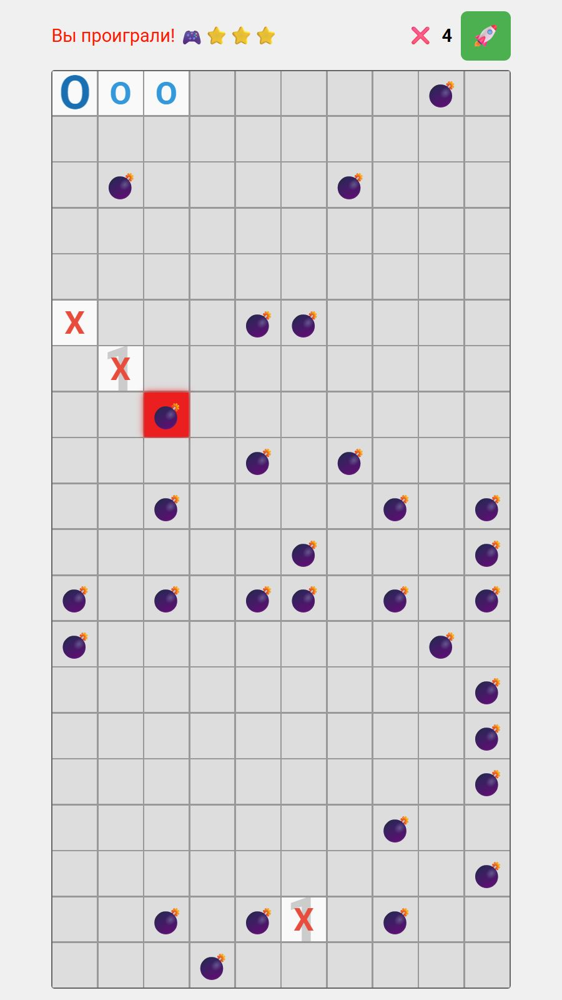

# Крестики-нолики с сапёром

Игра против компьютера, в которой нужно собирать крестики в линию и учитывать расположение скрытых мин. Числа в открытых клетках показывают количество мин вокруг, а попадание на мину приводит к проигрышу матча.

## Скриншоты игры

*Игрок ставит крестики, компьютер — нолики. Числа в открытых клетках показывают количество мин вокруг.*

*После попадания на мину матч заканчивается поражением, а мины становятся видны. Клетка, на которой произошёл проигрыш, выделена красным.*

## Зачем я её сделал

На премьере одной из нейросетей прозвучала мысль: создавать знакомые игры с помощью ИИ просто, поскольку модели обучены на множестве игр. А объединение разных механик в уникальной игре уже может показать реальные возможности ИИ.

Мне очень понравилась эта идея. Попробовали такой подход со студентами на занятии. Я придумал ряд сочетаний игр и одним из наиболее несовместимых сочетаний, были крестики-нолики с минами. Я решил сам тоже создать такую игру в чат-боте ChatGPT.

Задача состояла в том, чтобы нейросеть сама предложила механику объединения этих игр. Было интересно посмотреть, как ИИ справится и насколько интересно будет играть в получившийся вариант.

## Как работают механики

Игрок ставит крестики, компьютер — нолики. Побеждает тот, кто первым соберёт нужное количество своих фигур подряд по горизонтали, вертикали или диагонали. На простой и обычной сложности требуется четыре фигуры, на сложной и экспертной — пять.

На поле скрыты мины. Если игрок выбирает клетку с миной, матч сразу заканчивается его поражением.

В открытых клетках числа показывают количество мин в восьми соседних клетках, включая соседние по диагонали. Эти подсказки помогают учитывать расположение мин при выборе следующих ходов. Мне понравился именно такой вариант подсказок; при работе над игрой были и другие варианты.

В игре также предусмотрена подсветка безопасных клеток. Существующие сложности отличаются количеством мин, длиной победной линии и количеством подсвечиваемых безопасных клеток.

## Как развивалась игра

Были разные варианты и похожие студенческие работы, но в них человек играл против человека. Я решил развить этот вариант до игры против компьютера, улучшить оформление и добавить разные сложности.

## Роль ИИ и моя работа

Весь код игры писал ChatGPT. Я работал с ИИ через чат и постепенно уточнял, что требуется сделать и изменить.

Сначала я скопировал весь сгенерированный код в файл игры. При дальнейшей доработке получал от ChatGPT готовые фрагменты и заменял ими соответствующие части файла. Сам код я не писал.

На момент создания игры ИИ-агенты ещё не были так распространены. Работа проходила через сообщения в чат-боте и перенос полученного кода в файл.

## Как я проверял игру

Я сам проверял игру в браузере на компьютере, а также на телефоне и интерактивном экране.

## Что получилось

Получилась полноценная игра, которая работала на различных устройствах и в которой была полностью реализована механика объединения крестиков-ноликов и сапёра.

Я часто использовал игру на мероприятиях. Она очень понравилась участникам мероприятий.

## Состав и автономный запуск

Я распространяю игру одним HTML-файлом. В него включены интерфейс, стили оформления, игровой код и необходимые шрифты. Файл можно скачать и открыть в браузере без подключения к интернету и дополнительных файлов.

Для текста используется шрифт Roboto в обычном, среднем и жирном начертаниях. Шрифты встроены в игру вместе с уведомлением об авторских правах и полным текстом лицензии SIL Open Font License 1.1.
